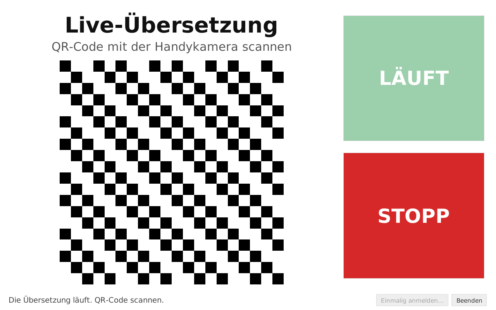

# Loghon Kiosk

A one-screen app for running [Loghon](https://www.loghon.com/) live translation
in church from a Linux Mint laptop.



- **START** (green): opens Loghon in a hidden browser, logs in, switches on
  audio, starts the translation, allows the microphone and shows the
  translation's **QR code** full size. People in the room scan it with their
  phone camera to follow the translation.
- **STOPP** (red): presses Loghon's own stop button (and confirms if Loghon
  asks), waits until Loghon shows it has stopped, and only then closes the
  hidden browser. The QR code disappears, since it only works while a
  translation is running. If the app can't confirm the stop, it does **not**
  close anything: it brings the Loghon window onto the screen so you can
  press stop there, then press STOPP in the app again.

The microphone is the laptop's default input. Choose it in Mint's
*Sound* settings → *Input* (built-in mic or a plugged-in microphone/mixer feed).

## Install (once)

```bash
git clone https://github.com/1lostsheep/loghon.git ~/loghon-kiosk
```

```bash
cd ~/loghon-kiosk && ./install.sh
```

This installs Python, Tk and a private copy of Chromium, and adds a
**Loghon Übersetzung** icon to the menu and the desktop.

## First run: log in once

1. Open **Loghon Übersetzung**.
2. Click **Einmalig anmelden…** (small button, bottom right). A normal browser
   window opens on app.loghon.com. It is not remote-controlled, so Loghon's
   Cloudflare "I'm human" check works there.
3. Log in with the church account, then close that browser window.

The login is kept in the app's own browser profile
(`~/.local/share/loghon-kiosk/browser-profile`), so you won't have to type it again.
If you'd rather have the app type it, put `username` and `password` in
`~/.config/loghon-kiosk/config.ini` (that file is only readable by your user
and is never part of this repository).

All text on the kiosk screen is German; change the title and subtitle in
`~/.config/loghon-kiosk/config.ini` under `[screen]`.

## Every Sunday

Open the app → **START** → turn the screen to the audience → **STOPP** after the talk.

Keys: `F11` toggles full screen, `Esc` leaves full screen.

## Teaching the app the real Loghon steps (once)

The app was written without access to loghon.com, so the button names in it are
guesses. To give it the real ones, record one walk-through on the laptop:

1. In the app, do **Einmalig anmelden…** (so the recording starts logged in), then quit the app.
2. Run:

   ```bash
   ~/loghon-kiosk/record.sh
   ```

3. A browser opens with a small "Playwright Inspector" window beside it. In
   the browser, do exactly what you'd do on Sunday: switch audio on, start the
   translation, allow the microphone, press record, open the QR code, then
   press stop and confirm. Then close the browser.
4. Open `~/loghon-recording.txt`, check there's no password in it, and send it
   to whoever maintains this repo. It lists each click with the exact button names.

## If a step doesn't work

The app finds Loghon's buttons by their visible text ("Start translation",
"Audio", "Stop", …). If Loghon uses different words, the status line at the
bottom says which step failed, and a screenshot plus the page's HTML are saved in
`~/.local/share/loghon-kiosk/logs/`.

To fix it:

1. Run the app with the browser visible, to watch what it does:

   ```bash
   ~/loghon-kiosk/run.sh --windowed --visible
   ```

2. Edit `~/.config/loghon-kiosk/config.ini`, section `[labels]`, and put
   the exact words Loghon shows on its buttons (e.g. `start_buttons = Begin translation`).
   If the start page isn't where translations are started, set `translation_url`.

Or send the screenshot from the `logs` folder to whoever maintains this repo.

## How it works

| File | Purpose |
|---|---|
| `loghon_kiosk/app.py` | Full-screen Tk window (QR code, START, STOPP, status line) |
| `loghon_kiosk/driver.py` | Drives loghon.com with Playwright/Chromium on a worker thread |
| `loghon_kiosk/config.py` | Reads `~/.config/loghon-kiosk/config.ini` |
| `config.example.ini` | All settings with explanations (copied on first run) |
| `record.sh` | Records a walk-through of the real site (Playwright codegen) |
| `tests/test_driver.py` | End-to-end test against a mock Loghon page in `tests/mock_site/` |

The QR code is a screenshot of the code Loghon draws on its page, scaled up
with sharp edges, and refreshed every 10 seconds while running. The microphone
prompt is accepted automatically (`--use-fake-ui-for-media-stream` only
auto-accepts the prompt; it still uses the real microphone).

Run the test (needs `pip install playwright pillow` and `playwright install chromium`):

```bash
python -m tests.test_driver
```
